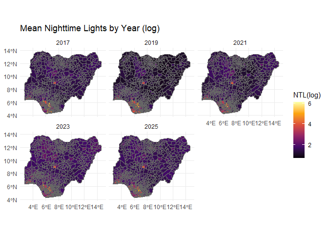
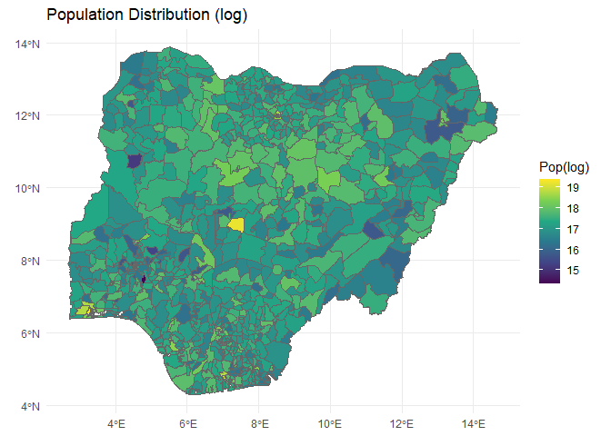
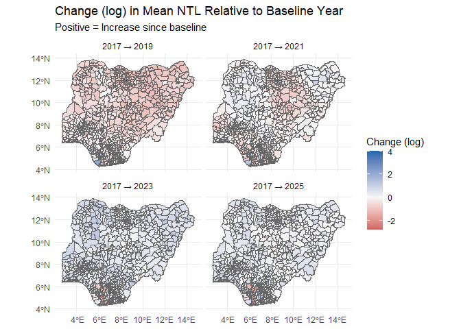
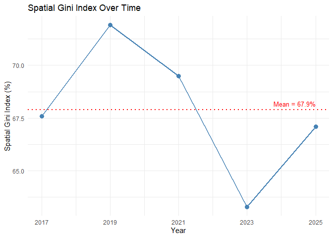
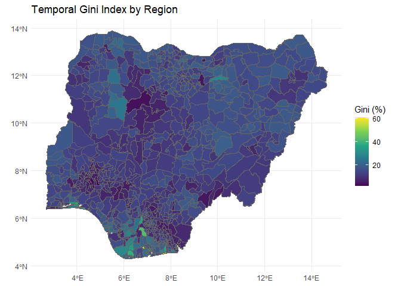
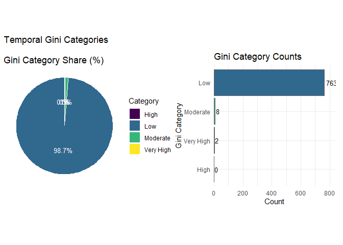
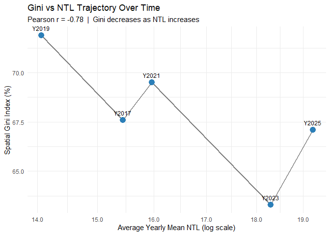

<!-- README.md is generated from README.Rmd. Please edit that file -->

# ginieq

<!-- badges: start -->

[](https://lifecycle.r-lib.org/articles/stages.html#experimental)
[](https://opensource.org/licenses/MIT)
<!-- badges: end -->

# 1. Introduction + Motivation

Nighttime light (NTL) satellite imagery has become an important proxy
for measuring human activity, economic development, electrification, and
urbanization. In countries where subnational economic statistics are
sparse or delayed, remotely sensed NTL provides a consistent way to
compare places through time, thereby supporting the United Nations’ SDG
10. Beyond measuring absolute light intensity, understanding how light
is distributed across space and how it changes over time provides
valuable insights into regional inequalities and development patterns.

The `ginieq` data analysis package was developed to quantify spatial and
temporal inequality in NTL emissions using the Gini index. The Gini
index ranges from 0% to 100%. Perfect equality (0%) means that everyone
in the population has the exact same income or wealth, while perfect
inequality (100%) indicates that a single person or entity possesses all
the income or wealth, while everyone else receives nothing. The package
computes yearly spatial Gini indices, evaluates temporal variability for
each administrative unit, and provides a suite of visualization tools
for interpreting these patterns. This vignette demonstrates a typical
workflow using Local Government Areas (LGAs) in Nigeria from 2017 to
2025.

`ginieq` can be used by local administrative authorities in Nigeria. By
revealing the spatial and temporal patterns of economic inequality
across years, the package will provide a foundation for more targeted
and evidence-based development policies. The workflow produces maps of
annual NTL emission, population distribution, NTL emission change
relative to 2017 (baseline), annual spatial Gini indices, LGA-level
temporal Gini indices, and the relationship between NTL emission and
Gini Index. Other key highlights include:

- Output stored in structured S3 objects: `ntl_merge`, `gini_data`,
  `spatial_gini`, and `temporal_gini`
- Custom S3 methods for `print()`, `summary()`, and `plot()`
- Built-in utility function `gini_utils.R` and ggplot2 visualizations

# 2. Data Description + Exploration

The example data consists of five (5) CSV files for the years 2017,
2019, 2021, 2023, and 2025. These files contain the remotely sensed
datasets aggregated for each local administrative area. The datasets
used are the SNPP-VIIRS nighttime light data and the global population
surfaces data, which are raster datasets that illustrate for each cell
the spatial distribution of nighttime light and the residential
population, respectively. The SNPP-VIIRS nighttime light data comes from
the Day/Night Band (DNB) aboard the Suomi NPP satellite and is operated
jointly by NASA and NOAA. The spatial and temporal resolutions are 15
arc-seconds (500 m) and daily. The GHS-POP dataset is maintained by the
European Commission Joint Research Centre (JRC) under the Copernicus
program. It has a spatial resolution of 100 m. Both datasets are
available on Google Earth Engine (GEE).

For each year, the datasets were filtered based on geometry, and zonal
statistics were performed for each administrative unit using reducers
for spatial and temporal statistics. Both datasets were integrated, and
the output was saved as a CSV file, which is used as the example data in
this package. If interested, the script to get the CSV from GEE can be
found here (<https://tinyurl.com/gee-datascript>).

To reproduce the analysis and explore the datasets, install and load the
package using the following commands:

## 2.1 Installation

Using the local `.tar.gz` package ‘ginieq_0.1.0.tar.gz’, install with:

``` r
install.packages("ginieq_0.1.0.tar.gz", repos = NULL, type = "source")
#> Warning in install.packages("ginieq_0.1.0.tar.gz", repos = NULL, type = "source"): installation of package 'ginieq_0.1.0.tar.gz' had non-zero exit status
```

## 2.2 Load the package

``` r
library(ginieq)
```

## 2.3 Aggregate NTL Data

`ginieq` ships with example datasets located in `inst/extdata`. The
`aggregate_ntl_data()` function takes up to 5 CSV files, where each row
represents an LGA. For each file it aggregates the 12 monthly **mean**
and 12 monthly **sum** NTL columns into a single yearly value each, then
merges all files together on the shape ID. The merged, yearly-aggregated
CSV is exported.

``` r
merged_data <- aggregate_ntl_data()
```

## 2.4 Prepare NTL Data

The `prepare_ntl_data()` function builds on `aggregate_ntl_data()`. It
takes the merged CSV file, filters by a country’s three-letter code,
wrangles it, and optionally writes a **cleaned CSV**, and returns an
`sf` object for analysis.

``` r
nigeria_sf <- prepare_ntl_data(country_code = "NGA")  # NGA is the official three letter code for Nigeria.

print(nigeria_sf)
#> <gini_data>: 773 regions | years: 2017, 2019, 2021, 2023, 2025 
#> CRS: EPSG:4326 
#> 
#>                     shapeID         system:index      pop shapeGroup shapeISO shapeName shapeType NTL_Yearly_Mean_Y2017 NTL_Yearly_Sum_Y2017 NTL_Yearly_Mean_Y2019
#> 1  NGA-ADM2-1590546715-B143 0000000000000000299d 15524094        NGA     None       Abi      ADM2              3.094987              35.1593              2.210110
#> 2  NGA-ADM2-1590546715-B102 0000000000000000299e 35229508        NGA     None       Ado      ADM2              2.525849             122.8818              1.644202
#> 3  NGA-ADM2-1590546715-B104 0000000000000000299f 18174548        NGA     None       Apa      ADM2              2.625435             106.1499              1.881820
#> 4  NGA-ADM2-1590546715-B464 000000000000000029a0  8372572        NGA     None       Asa      ADM2              3.806754             198.2288              4.346050
#> 5  NGA-ADM2-1590546715-B489 000000000000000029a1 20317848        NGA     None       Awe      ADM2              2.782495             289.5740              1.490755
#> 6  NGA-ADM2-1590546715-B126 000000000000000029a2 42541047        NGA     None       Biu      ADM2              3.879355             525.1983              2.334368
#> 7  NGA-ADM2-1590546715-B465 000000000000000029a3 34679476        NGA     None       Edu      ADM2              3.185952             328.7403              2.140945
#> 8  NGA-ADM2-1590546715-B749 000000000000000029a4 25888572        NGA     None       Epe      ADM2              6.238178             199.8435              6.703776
#> 9  NGA-ADM2-1590546715-B653 000000000000000029a5 13563254        NGA     None       Ibi      ADM2              2.763854             299.8354              1.730047
#> 10 NGA-ADM2-1590546715-B578 000000000000000029a6 34472912        NGA     None       Ido      ADM2             11.056812             439.1844             11.255843
#>    NTL_Yearly_Sum_Y2019 NTL_Yearly_Mean_Y2021 NTL_Yearly_Sum_Y2021 NTL_Yearly_Mean_Y2023 NTL_Yearly_Sum_Y2023 NTL_Yearly_Mean_Y2025 NTL_Yearly_Sum_Y2025
#> 1              24.52747              3.281991             36.22007              4.210410             47.55492              3.349434             37.38513
#> 2              77.55885              2.457144            120.18427              4.248189            208.49957              2.672360            131.56462
#> 3              75.80313              3.048578            123.25097              4.468237            180.43081              3.717356            150.27258
#> 4             225.22801              4.895395            253.56085              6.972685            361.90392              6.726794            349.74626
#> 5             152.31721              2.630106            273.72046              3.459174            359.99059              3.227860            335.40009
#> 6             315.76068              3.959618            536.08574              5.616119            760.35650              4.452879            602.73112
#> 7             220.42933              3.446853            355.35347              4.067703            419.57955              3.659291            377.58142
#> 8             214.47756             11.567557            371.19201             13.861529            444.78569             38.992976           1251.49253
#> 9             185.85636              2.339308            253.80944              3.410927            369.60243              3.461274            375.10605
#> 10            446.00078             10.610328            419.41396             13.960222            553.14283             12.661539            502.13264
#> # ... with 763 more rows
```

# 3. Analysis + Results

The primary objective is to quantify inequality (Gini Index) in NTL
distribution across both space and time. The Gini index can be
calculated using the following formula:
$$G = \frac{\sum_{i=1}^{n} \sum_{j=1}^{n} |x_i - x_j|}{2n^2 \bar{x}}$$

Where $x_i$ and $x_j$ are individual values, $n$ is the total number of
observations, and $\bar{x}$ is the mean value.

## 3.1 How Are Nighttime Light Emissions Distributed Across Nigeria LGAs?

The analysis begins by visualizing the geographical distribution of NTL
emissions for selected years.

``` r
plot(nigeria_sf, var = "ntl_yearly")
```



## 3.2 How is Population Distributed Across Nigeria LGAs?

Population distribution is also mapped to provide additional context.
Large NTL values in major urban LGAs may reflect high population
density, intense economic activity, or both.

``` r
plot(nigeria_sf, var = "pop")
```



## 3.3 How Have Nighttime Light Emissions Changed Since the Baseline Year (2017)?

To assess development dynamics, `ginieq` calculates the change in NTL
emissions relative to the baseline year.

``` r
plot(nigeria_sf, var = "ntl_change")
```



## 3.4 Has Spatial Inequality Increased or Decreased Over Time across Nigeria LGAs?

`ginieq` computes the Spatial Gini Index independently for each year.
The resulting annual values summarize how evenly nighttime light
emissions are distributed across all LGAs.

``` r
spatial_g <- compute_spatial_gini(nigeria_sf, tempdir())
#> Mean spatial Gini across all years: 67.9%
print(spatial_g)
#> <spatial_gini>: yearly spatial inequality
#> 
#>            Year Mean_NTL Gini_Coefficient Gini_Category
#>           Y2017  15.4442             67.6     Very High
#>           Y2019  14.0599             71.9     Very High
#>           Y2021  15.9698             69.5     Very High
#>           Y2023  18.3035             63.3     Very High
#>           Y2025  19.2057             67.1     Very High
#>  All_Years_Mean  16.5966             67.9     Very High
```

The annual Gini values are displayed as a trend chart, enabling users to
examine whether spatial inequality has increased, decreased, or remained
stable throughout the study period.

``` r
plot(spatial_g, type = "trend")
```



## 3.5 What Does the Temporal Gini Index Reveal About the Stability of NTL Emissions in Nigeria LGAs?

`ginieq` estimates the Temporal Gini Index for every LGA using its
annual NTL time series. This statistic measures the **temporal
stability** of each area’s nighttime light emissions between 2017 and
2025.

``` r
temporal_g <- compute_temporal_gini(nigeria_sf, tempdir())
```

The temporal Gini results are presented as a choropleth map, allowing
users to identify geographical clusters of stable and highly dynamic
LGAs.

``` r
plot(temporal_g, type= "map")
```



Additional pie and bar charts summarize the percentage and count of LGAs
within predefined temporal Gini categories.

``` r
plot(temporal_g, type= "category")
```



## 3.6 What is the Relationship Between Nighttime Light Emissions and Gini Index?

Finally, `ginieq` explores the relationship between annual NTL emissions
and spatial inequality through a scatter plot comparing NTL emission
value against the spatial Gini index.

``` r
plot(spatial_g, type = "scatter")
```



# 4. Discussion of Results

The analyses demonstrate how NTL-derived Gini indices can be applied to
characterize the spatial and temporal development pattern in data-scarce
regions.

NTL emission maps show emissions concentrated around major metropolitan
areas, while rural LGAs remain less illuminated. Difference maps
identify areas of growth, decline, and emerging development corridors. A
spatial Gini value approaching zero indicates relatively uniform
distribution, whereas larger values indicate a stronger concentration of
emissions within a limited number of LGAs. Areas with low temporal Gini
values exhibit relatively stable illumination over time, whereas higher
values indicate substantial fluctuations that may reflect rapid
development or economic disruption. The scatter plot reveals an inverse
relationship between NTL emission and the Gini Index.

Although this vignette focuses on Nigeria, `ginieq` offers a
reproducible workflow that can be applied to any administrative
geography with annual NTL observations.
